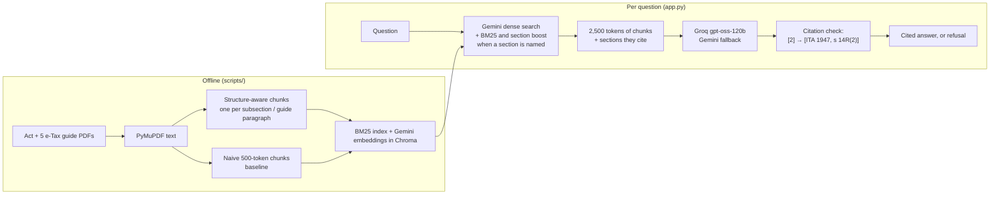

# BC3415 Tax RAG

Cited answers to Singapore corporate income tax questions, retrieved from the
Income Tax Act 1947 and IRAS e-Tax guides. Built for tax associates at SME-focused
accounting firms. NTU BC3415 *AI in Accounting & Finance* group project.

The core claim, measured and not just asserted: **structure-aware chunking +
hybrid retrieval beats naive fixed-size chunking on legal text.**

**Status:** all five phases are built and the app is live on Render (password-protected). Both Gemini indexes
(structure-aware and naive) are complete. See [`docs/PLAN.md`](docs/PLAN.md).

## How it works



Design decisions, each argued in [`docs/PLAN.md`](docs/PLAN.md):

- **Chunks follow the law's structure.** One chunk per subsection of the Act and per paragraph of a
  guide, each labelled with its citation, so an answer can cite `[ITA 1947, s 14R(2)]` rather than a
  document.
- **Retrieval routed by question.** Embeddings catch paraphrase; BM25 catches exact section numbers. Plain
  questions use dense search alone (blending in BM25 lowered its ranking quality); questions that name a
  section also get BM25 and a section boost, merged by rank (RRF).
- **Citations the model can't invent.** The model cites numbered sources; the code turns the numbers into
  citations and drops numbers that weren't sources. An answer with no valid citation becomes a refusal.
- **Equal-context evaluation.** Chunkers are compared at the same amount of text, not the same number of
  chunks: five naive chunks hold six times the text of five structured ones.
- **Fits Render's free tier.** Embeddings come from the Gemini API (no torch); the app peaks at ~200 MB.

## Results

Retrieval and answers on 25 questions with gold sections and paragraphs, plus 3 the corpus can't answer.
Full tables and caveats: [`results/metrics.md`](results/metrics.md) and [`docs/PLAN.md`](docs/PLAN.md).

| Both searched with Gemini embeddings | naive 500-token chunks (`baseline`) | structure-aware chunks (`improved`) |
|---|---|---|
| Right sources found, same 2,500 tokens of context | 0.67 | **0.81** |
| How high the first right source ranks (MRR@10) | 0.62 | **0.80** |
| Citations naming an exact section or paragraph | 0% | **100%** |
| Answerable questions answered (of 10) | 10 | 10 |
| Out-of-scope questions refused | 3/3 | 3/3 |

`improved` searches with Gemini embeddings and adds BM25 and the section boost only when a question names a
section: on these questions, dense search alone did best on plain-language questions, hybrid on section
references.

### Optional: A* dependency expansion (`improved_astar`)

`improved` appends the first chunk of up to 3 sections its hits cite. `improved_astar` keeps the same hits and
instead lets an A* search ([`rag/graph.py`](rag/graph.py)) add what they depend on, cheapest first, within the
same ~450 extra tokens:

- the subsections and sections they refer to;
- the subsection that defines their terms ("In this section ...");
- the earlier piece of a split provision.

It also follows the dependencies of what it added, while the allowance lasts. It cannot cover them all, so
its context ends up with more unresolved references than `improved`'s. It needs no embeddings: the graph is
built from the chunks' text on first use (0.2 s, under 10 MB). It adapts the A* search of Experiment 3 in
[Legal_RAG_Exp](https://github.com/Khawpuneiei/Legal_RAG_Exp) (`docs/experiment3-results.md`, R6) to this
corpus (condition R6y).

Results on 79 held-out answerable questions, with Gemini embeddings and the same hits for both:

| Context sent to the model | `improved` | `improved_astar` |
|---|---|---|
| Gold sections and paragraphs in it | 0.918 | 0.926 |
| The hits' own cross-references, definitions and split pieces resolved in it | 0.499 | **0.706** |
| References left unresolved in the context (lower is better) | 19.9 | 26.0 (its additions bring their own) |
| Tokens | 2,753 | 2,766 |
| Answers judged correct (qwen2.5:7b, blind; partial = half) | 0.513 | 0.506 (no significant difference) |
| Answers judged correct (qwen3:8b, a reasoning model, under the 2,000-token cap) | 0.728 | 0.753 (no significant difference) |

Not yet tested with the app's own models (gpt-oss-120b, Gemini Flash), so the app still uses `improved`. To
try it, change `IMPROVED` in `app.py` to `("Structure-aware (this project)", "improved_astar", "improved_bm25")`, or:

```bash
python scripts/ask.py --config improved_astar --sources "Can a loss-making company transfer its losses to a sister company?"
```

## Demo video

[`results/demo.mp4`](results/demo.mp4) (3 min, narrated) walks through the app; the narration with timestamps
is in [`results/demo_script.md`](results/demo_script.md). To record it again after a change:

```bash
python -m playwright install chromium     # once
python scripts/record_demo.py             # narrated with a Windows voice; --no-voice for captions only
```

## Setup

```bash
uv venv --python 3.11 .venv          # or: python3.11 -m venv .venv
.venv\Scripts\activate               # macOS/Linux: source .venv/bin/activate
uv pip install -r requirements-dev.txt
cp .env.example .env                 # add GROQ_API_KEY and GEMINI_API_KEY
pytest
```

## Build and query the index

```bash
python scripts/build_chunks.py       # PDFs in data/raw/ -> chunks in data/processed/
python scripts/build_index.py        # BM25 + Gemini dense index in index/ (~45 min on the free tier; resumable)
python scripts/search.py "Can a company deduct expenses incurred before it started business?"
python scripts/ask.py "Can a company deduct expenses incurred before it started business?"
```

Without `GEMINI_API_KEY`, use `build_index.py --bm25-only` and `search.py --config structured_bm25_boost`.

## Evaluate

```bash
python scripts/evaluate.py                # retrieval metrics -> results/metrics.md, results/comparison.png
python scripts/evaluate.py --answers 10   # + generated answers -> results/answers.md
```

Configs whose dense index isn't complete are listed as pending. Query embeddings are cached in
`index/query_embeddings.json`, so reruns don't use up the Gemini quota.

## Run the app

```bash
streamlit run app.py                 # http://localhost:8501; set APP_PASSWORD in .env to test the sign-in
```

## Deploy to Render

1. In the Render dashboard: **New > Blueprint**, connect this GitHub repo. Render reads `render.yaml`
   (free web service, Python 3.11, `streamlit run app.py`).
2. When asked, enter `GROQ_API_KEY`, `GEMINI_API_KEY` and `APP_PASSWORD`. Share the password with your
   team and graders; it keeps the IRAS content and your API quota private.
3. Deploy. The free tier sleeps after 15 minutes idle, so the first visit afterwards takes about a minute.

The index the app reads is committed under `index/` (private repo). After rebuilding it, commit the changed
files and Render redeploys. Once `scripts/build_index.py` completes, add the Chroma index with
`git add -f index/chroma` so the app uses hybrid search instead of BM25. "Compare with the naive baseline"
makes two model calls per question, so on Groq's free tier it can take 30-40 s.

## Source documents

The Income Tax Act 1947 (2020 Revised Edition, from Singapore Statutes Online) and five IRAS
e-Tax guides on corporate income tax. The PDFs are not in git; download them into `data/raw/`
using the links and checksums in [`data/raw/SOURCES.md`](data/raw/SOURCES.md). The app itself
never scrapes or downloads anything.

## Layout

```
rag/          library code: parsers, chunk schema, reference detector, retrieval, generation
tests/        pytest; tests/fixtures/sample_act.txt is a synthetic Act (not real law)
eval/         questions.jsonl: questions with gold sections/paragraphs (scripts/evaluate.py scores them)
data/raw/     source PDFs        data/processed/  parsed chunks (JSONL)
index/        BM25 index + chunks (committed, shipped to Render); Chroma once complete
app.py        Streamlit app; render.yaml deploys it
results/      metrics.md, comparison.png, answers.md, data_quality.md
docs/PLAN.md  phase plan, design decisions, open questions
```
