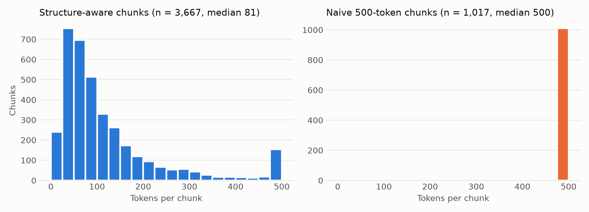

# Data quality report

Generated by `scripts/data_quality.py` from the files listed in `data/raw/SOURCES.md`.

## 1. Document versions

| Document | Edition | Date | vs Act version |
|---|---|---|---|
| Income Tax Act 1947 | 2020 Revised Edition | in force from 11 Sep 2026 | - |
| e-Tax Guide: Group Relief System | Third | published 30 Jan 2026 | pre-dates by 224 days |
| e-Tax Guide: Expenses Incurred Prior to Commencement of Business | Third | published 30 Jan 2026 | pre-dates by 224 days |
| e-Tax Guide: Date of Commencement of Business | Third | published 30 Jan 2026 | pre-dates by 224 days |
| e-Tax Guide: Carry-back Relief System | Ninth | published 30 Jan 2026 | pre-dates by 224 days |
| e-Tax Guide: Renovation or Refurbishment Works | Eighth | published 30 Jan 2026 | pre-dates by 224 days |

- All guides post-date the 2020 Revised Edition (operative 31 Dec 2021) and cite its section numbers.
- 4 Act sections carry amendments effective after 30 Jan 2026 (the guides' publication date), so the guides may not reflect them: s 13 (2026-07-01), s 14O (2026-07-01), s 14Z (2026-08-01), s 14ZG (2026-07-01).
- Of those, cited by the guides: none.

## 2. Parse coverage

- **Act sections:** 354 parsed of 354 listed in the Arrangement of Sections (missing: none; extra: none).
- **Repealed** (not indexed): 11 sections (18A, 29, 30, 40, 44, 44A, 47, 48, 61, 71A, 105C), plus 88 deleted subsections ("[Deleted by Act ...]").
- **No heading found:** s 37AA.
- **Renumbered in 2020:** 98 sections carry their pre-2020 number as metadata.

| Guide | Numbered paragraphs | Annexes | Headings (inferred) | Footnote/small-print lines dropped (< 10 pt) |
|---|---|---|---|---|
| e-Tax Guide: Group Relief System | 59 | 8 | 20 (0) | 540 |
| e-Tax Guide: Expenses Incurred Prior to Commencement of Business | 27 | 2 | 9 (0) | 40 |
| e-Tax Guide: Date of Commencement of Business | 17 | 0 | 6 (0) | 16 |
| e-Tax Guide: Carry-back Relief System | 59 | 9 | 13 (0) | 502 |
| e-Tax Guide: Renovation or Refurbishment Works | 30 | 0 | 12 (0) | 18 |

| Chunks | Count | Empty | < 10 tokens | Split (> 500 tokens) | Min | Median | P95 | Max |
|---|---|---|---|---|---|---|---|---|
| Structure-aware | 3,667 | 0 | 13 | 238 | 1 | 81 | 428 | 500 |
| Naive | 1,017 | 0 | 0 | 0 | 108 | 500 | 500 | 500 |

## 3. Cross-reference integrity

- 2,330 of 2,339 section references in chunks (99.6%) resolve to a parsed Act section.
- Unresolved: s 759 (act, 3×), s 66A (act, 1×), s 43Y (act, 1×), s 43Z (act, 1×), s 43ZB (act, 1×), s 43ZC (act, 1×), s 43ZD (act, 1×).
- Point to repealed sections: s 18A (act, 5×), s 40 (act, 1×), s 18A (guide, 1×).
- 9 of the 30 distinct section numbers the guides cite were used for a different provision before 2020 (e.g. s 14Q was renovation and refurbishment, now s 14N). The guides use 2020 numbering, so references resolve under it; the one explicit legacy citation is the renovation guide's "unabsorbed S14Q (S14N of the 2020 Revised Edition)".

## 4. Known gaps and limitations

- **Schedules not indexed:** the 12 schedules (PDF pages 1225-1323) are outside the parsed body.
- **Formulas:** symbol-font glyphs (ð, Þ, þ) extract as Latin letters in 16 sections (s 10G, s 10L, s 14, s 14D, s 14L, s 14M, s 14Z, s 14ZI, s 37D, s 37F, s 37G, s 37R, s 45E, s 45EA, s 49, s 81); their formulas are unreadable in chunks.
- **Guide footnotes and tables:** footnotes are dropped with other text under 10 pt; tables are flattened to lines, so cells lose their column.
- **Residual spacing errors:** a few guide words run together (e.g. "systemallows" in Group Relief para 5.1); not measured.
- **Outside the corpus:** subsidiary legislation (rules, regulations, orders), other e-Tax guides, IRAS web pages and case law. Questions on these must be answered "not covered".
- **Guides are IRAS's interpretation, not law;** where a guide and the Act differ, the Act governs.
