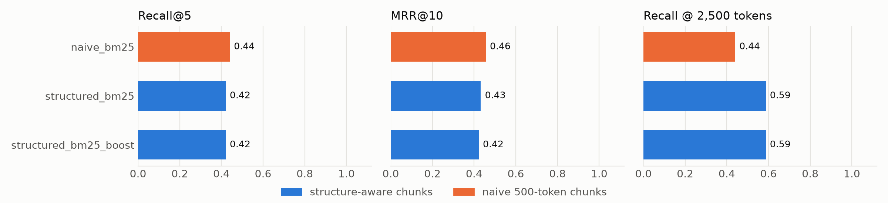

# Retrieval evaluation

Generated by `scripts/evaluate.py` on 2026-10-15 from `eval/questions.jsonl`: 28 questions, 25 with gold labels, 3 out of scope. Question set status: **DRAFT (not yet reviewed)**.

| Config | Corpus | Retrieval | Recall@5 | MRR@10 | Recall @ 2,500 tokens |
|---|---|---|---|---|---|
| `naive_bm25` | naive | BM25 | 0.44 | 0.46 | 0.44 |
| `structured_bm25` | structured | BM25 | 0.42 | 0.43 | 0.59 |
| `structured_bm25_boost` | structured | BM25 + section boost | 0.42 | 0.42 | 0.59 |

**Pending** (rerun when the dense index is complete):

- `naive_dense`: the dense index for 'naive' has 0 of 1017 chunks: finish python scripts/build_index.py, or use a BM25 config
- `structured_dense`: the dense index for 'structured' has 1700 of 3577 chunks: finish python scripts/build_index.py, or use a BM25 config
- `structured_hybrid`: the dense index for 'structured' has 1700 of 3577 chunks: finish python scripts/build_index.py, or use a BM25 config
- `structured_hybrid_boost`: the dense index for 'structured' has 1700 of 3577 chunks: finish python scripts/build_index.py, or use a BM25 config

## Recall@5 by question type

| Config | natural (n=20) | section_ref (n=3) | old_number (n=2) |
|---|---|---|---|
| `naive_bm25` | 0.36 | 0.78 | 0.75 |
| `structured_bm25` | 0.35 | 0.67 | 0.75 |
| `structured_bm25_boost` | 0.35 | 0.67 | 0.75 |

## How to read this

- A chunk is relevant when it belongs to a gold Act section or guide paragraph; naive chunks, which have no labels, count when their character span overlaps a gold unit's span.
- Recall@5 is the share of a question's gold units found in the top 5; MRR@10 is the mean of 1/rank of the first relevant chunk.
- Top-5 is not equal context: a naive chunk is 500 tokens, a structured one ~80 (median). Recall @ 2,500 tokens takes chunks in rank order until 2,500 tokens, the size of five naive chunks, so both chunkers get the same amount of text.

## Generated answers

The first 10 questions with gold labels plus every out-of-scope one, per config. Citation precision is the share of an answer's citations that point at a gold unit; the answers themselves are in [`answers.md`](answers.md) for manual review.

| Config | Answered | Refused (answerable) | Citation precision | Out-of-scope refused |
|---|---|---|---|---|
| `structured_bm25_boost` | 8/10 | 2 | 0.52 (over 8) | 3/3 |
| `naive_bm25` | 8/10 | 2 | 0.42 (over 8) | 3/3 |
